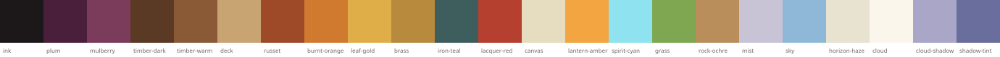

Status: Draft (2026-11-01). The developer owns this document: agents propose changes, the developer decides.

# Art direction

How TinCan looks and feels, written so that a person or an agent making a model, material, shader or effect can
check their work against it. It holds the decisions about the look. The technical contract for meshes is in
[`plans/airship-parts-pack.md`](plans/airship-parts-pack.md) ("The mesh contract for Blender parts"). Marked
**(proposal)**: a starting value an agent picked; the developer confirms or replaces it.

## The feel in one sentence
A hand-made, lived-in sky world in autumn light: patched wooden airships held up by spirits and pushed by
clattering propellers, drifting through humid, glowing mist between painted clouds and islands, cosy inside and vast
outside.

## Inspirations, and what we take from each
| Source | Take | Leave |
|---|---|---|
| Howl's Moving Castle | Things built up over time: patches, add-ons, mismatched parts, mechanisms you can see working (gears, chimneys, flaps). Nothing quite symmetrical or quite straight. | The castle's scale of clutter on small parts: our parts must read at a distance. |
| Spirited Away | Red lacquer and lanterns, warm interiors against a cool dusk sky, spirits that glow softly. Bathhouse richness on special places, not everywhere. | Horror beats. |
| Final Fantasy IX | Chunky, rounded, storybook proportions; airships with propellers, paddles and rotor masts; saturated ochre, red and teal. Every prop has character. | Pre-rendered backdrops and photographic detail. |
| Ori and the Blind Forest | Atmosphere: air you can see. Layered mist where light and shadow blend into each other, light bleeding into humid air around every glow, deep darks next to luminous highlights, and soft focus on near and far layers so the eye goes to the middle. | Its side-on 2D parallax set-up, and blur that hides what a player needs to read. |
| Autumn | The palette: leaves turning russet, burnt orange and gold over earthy browns, with deep plum and near-black in the shadows. | |
| Studio Ghibli overall | Painterly skies with huge clouds, soft light with coloured shadows, flat colour with gentle gradients instead of fine texture, wind in grass, cloth and hair. Calm moments. | Anything that needs hand-drawn 2D to work. |

## Pillars
Each pillar is a test an asset passes or fails.
1. **Hand-made.** Every man-made thing looks like someone built and mended it: visible planks, pegs, bands, rivets,
   patches. Nothing machine-perfect: lean posts a degree or two, vary plank widths, offset repeating parts.
2. **Readable shapes first.** The silhouette carries the object. Chunky and rounded; big, medium, small detail in about
   60/30/10 proportion. Detail goes in geometry and colour, not in texture noise.
3. **Warm against cool, light out of the dark.** Lit surfaces warm (cream, ochre, timber, autumn leaf), shadows and
   distance cool (lilac, plum). Darks are allowed and wanted: deep plum and ink give the glows something to shine
   against. Shadows are coloured, never grey; nothing is pure `#000` or pure `#FFF`.
4. **Alive.** Anything that could move does, a little: rotors turn, pennants and sails sway, lanterns flicker, grass
   bends, spirits drift. Motion is slow and soft (seconds per cycle), never jittery. A part with a moving piece is not
   finished until it moves.
5. **Magic is soft light.** Spirits and magic glow in pale cyan and warm gold, with soft falloff and gentle pulsing,
   not hard neon or particle storms.
6. **Air you can see.** Mist and haze sit between every layer of the view, so depth reads as fading colour and softening
   focus. Light bleeds into the air around it (lanterns, the spirit, the sun through cloud), and layers blend into each
   other rather than meeting at hard edges.

## Shape language
- Proportions exaggerated toward the storybook: thick posts, heavy rails, big rivets and hubs, oversized
  props (lanterns, wheels, flags) about 1.2–1.5 times real size.
- Bevel or round every visible hard edge; a sharp edge is a deliberate accent (a blade's tip, a spike).
- Curves sag and swell: hulls are round-bellied, roofs dip, masts taper.
- Layer materials: wood structure, metal bands at joints, cloth on top. Brass at the places hands touch.

## Colour
One palette for the whole world (the 3D counterpart of `Assets/UI/Theme/Tokens.uss`). Assets use these roles, not
free colours. **(proposal)** The swatches are SVGs in [`art/palette/`](art/palette/) (`palette.svg` is the whole set);
when a colour changes, change its swatch too.

| | Role | Hex | Used for |
|---|---|---|---|
|  | Ink | `#1C1719` | The deepest darks: night, the inside of holds and hatches, silhouettes against glow |
|  | Plum | `#4A1F3B` | Deep shadow at dusk and night, far silhouettes in mist |
|  | Mulberry | `#7B3B5A` | Dusk sky bands, shadowed cloth, spirit-world accents |
|  | Timber dark | `#5A3A24` | Hull sides, beams, frames |
|  | Timber warm | `#8A5A36` | Rails, posts, furniture |
|  | Deck | `#C9A473` | Plank floors |
|  | Russet | `#9E4A28` | Autumn foliage, painted wood, worn leather |
|  | Burnt orange | `#D07A30` | Autumn foliage, sunset light, warm accents |
|  | Leaf gold | `#E0AE48` | Autumn foliage highlights, light through leaves |
|  | Brass | `#B88A3E` | Hubs, bands, fittings, finials |
|  | Iron teal | `#3E5E5E` | Masts, machinery, pipes |
|  | Lacquer red | `#B5402F` | Flags, roofs, accents, special places |
|  | Canvas | `#E6DCC0` | Sails, rotor blades, awnings |
|  | Lantern amber | `#F2A541` | Lanterns, windows at dusk, warm glow |
|  | Spirit cyan | `#8FE3F0` | The cairn's spirit, magic, interaction glow |
|  | Grass | `#7FA650` | Island tops |
|  | Rock ochre | `#B98E5A` | Island strata |
|  | Mist | `#C9C3D6` | The haze between layers of the view; tinted by the light it carries |
|  | Sky | `#8FB8D8` | Day sky |
|  | Horizon haze | `#E8E2D0` | The sky at the horizon, aerial perspective |
|  | Cloud | `#FBF6EC` | Cloud light |
|  | Cloud shadow | `#A9A6C8` | Cloud undersides |
|  | Shadow tint | `#6A6E9C` | What shadows lean toward instead of black |

## Materials
A small, fixed library shared by every asset, so ships batch and stay consistent. A Blender asset names its materials
after these roles; the asset builder swaps them for the shared Unity materials (the rotor mast does this already:
`ShipDesignsAssetBuilder.RotorMastPrefab`). Today's shared ship materials, in `Assets/Materials/ShipParts/`:
`M_ShipHull` (timber), `M_ShipDeck`, `M_ShipEngine` (brass), `M_ShipIron`, `M_ShipCanvas`, `M_ShipPennant`, `M_ShipCairn`,
`M_ShipSpirit`. Variation within a material comes from vertex colour (wear, dirt, sun-bleach), not from new
materials.

## Light and shading (the look)
Most of the feel comes from here, not from the models. The target **(proposal)**:
- **One stylized lit shader** for world assets: wrapped diffuse banded into two or three soft steps, shadows tinted
  toward the shadow tint, a soft sky-coloured rim, ambient from the sky, little or no specular. Metal reads as metal by
  colour and a soft highlight band, not by reflections. Vertex colour multiplies the base (ambient occlusion, wear).
  `Assets/Shaders/SkyIsland.shader` (wrapped diffuse, vertex-colour masks) is the nearest thing today.
- **No ink outlines** on the world; `TargetOutline` stays the interaction highlight only.
- **Sky and clouds** painterly: big soft cloud shapes, a warm horizon haze, aerial perspective (distance fades toward
  the sky colour).
- **Atmosphere (after Ori):** height fog in layers, densest in the cloud sea and thinning upward, tinted by the light
  that crosses it (gold toward the sun, plum and blue away from it). Light shafts where sun or lanterns cross mist.
  Every glow carries a wide, soft halo, so light bleeds into the air instead of stopping at the object. Far islands
  and ships become flat, misty silhouettes in two or three depth bands.
- **Depth of field:** soft focus pushes depth, but never on what a player must read. In play: a gentle blur only on
  far layers (beyond the play space, with the mist), none near the ship. In the shipyard, menus, the map and
  cutscenes: real depth of field, foreground and background soft.
- **Post:** gentle colour grading toward warm highlights and plum-cool shadows, wide soft bloom on glows (the halo
  above), no lens dirt, no heavy vignette.
- **Times of day** shift the whole palette (warm noon, golden dusk with lanterns, blue night with spirit glow) through
  the grading and the light, not per asset.

## Motion and life
- Rotors and propellers spin about their manifest axis, faster with the ship's speed, idling when still.
- Cloth (pennants, sails, awnings) sways in the material, without animation clips: cheap, batched, never in sync
  across instances.
- Lanterns flicker, spirits drift and pulse, slowly.
- Motion is cosmetic and local to each peer: nothing is replicated for it.

## Budgets and technical rules
The mesh contract in [`plans/airship-parts-pack.md`](plans/airship-parts-pack.md) applies (Y-up, 1 unit = 1 m, fits its
blocks, pivot rule, simple separate collision, moving parts as named children, a `manifest.json`). In addition
**(proposal)**: a ship part at most 3k triangles, a large prop 5k, a small prop 1k; materials only from the library;
no bitmap textures on ship parts (vertex colour and the shader carry the look); every asset is rebuilt from a script
(`.tools/blender/`), never hand-edited only.

## References
Inspiration images guide mood only. No asset, texture or silhouette is traced or copied from someone else's work,
including the concept art these documents mention. A reference board for the project should hold the developer's own
sketches and paintovers, and links rather than copies of others' images.

## Reviewing an asset
An asset is done when a turntable or in-game render shows it and each answer is yes:
1. Does it pass all six pillars?
2. Does the silhouette read at 30 m?
3. Does it use only palette roles and library materials?
4. Does every moving piece move?
5. Does it fit its contract (blocks, pivot, budget, colliders), checked by the tools?
6. Did the developer see the render and accept it?

## Today, and the gap
- Ship parts are greybox primitives on URP Lit, except the rotor mast (the first Blender part, on URP Lit).
- The frame hull uses one deck material for planks and one beam material; hull sides cannot yet differ from decks.
- Sky islands and clouds have their own shaders and are closest to the target.
- The UI is a grey placeholder theme ([`UI_FRAMEWORK.md`](UI_FRAMEWORK.md), [`plans/ui-and-menus.md`](plans/ui-and-menus.md)).
- Third-party packs are present: `Assets/Stylized_Pirate_Ship/`, `Assets/Fantasy Skybox FREE/`, volumetric clouds
  (`Assets/ThirdParty/`).

## Decided
- 2026-11-01: the earthy palette stays, leaning into autumn (russet, burnt orange, leaf gold), with a dark end (ink,
  plum, mulberry). Ori and the Blind Forest joins the inspirations for its misty, glowing atmosphere and soft-focus
  depth.

## Open questions for the developer
1. The new darks and autumn colours: right shades, or adjust after seeing them in a render?
2. Shading: two or three bands, and how hard the band edges are (painterly soft or crisp cel)?
3. Outlines: none (proposed), thin on characters only, or everywhere?
4. Characters: how stylized (FF9 chibi proportions, or Ghibli realistic proportions)?
5. The third-party packs: keep as placeholders, restyle them, or remove them once our own assets exist?
6. Which time of day is the hero look the first slice should nail?
7. Depth of field in play: only on far layers (proposed), or none at all in first person?
